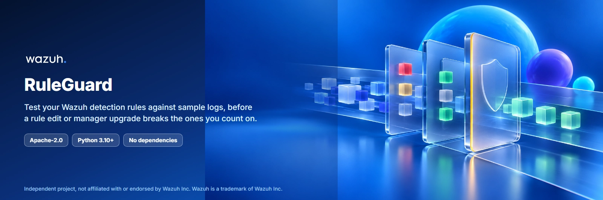
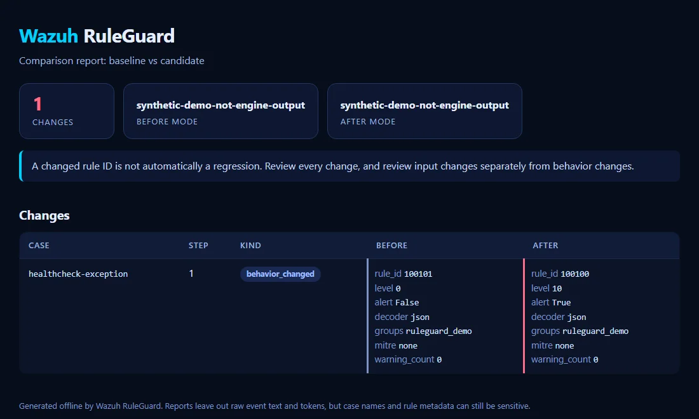
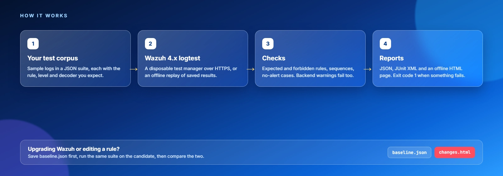

<h1 align="center"></h1>

<p align="center">
  <a href="https://github.com/farhan6667/wazuh-ruleguard/actions/workflows/ci.yml"></a>
  <a href="LICENSE"></a>
  
  
  
</p>

**Wazuh RuleGuard is an open source command line tool for Python 3.10+ that tests Wazuh 4.x detection rules against a JSON suite of sample logs and tells you which detections changed after a rule edit or a manager upgrade.** Independent project by Syed Farhan Ahmed (SFA) at NexaForge. It is not affiliated with, sponsored by or endorsed by Wazuh Inc.

<p align="center">
  <a href="https://opencollective.com/nexaforge-oss"><picture>
    <source media="(prefers-color-scheme: dark)" srcset="docs/img/sponsor-button-dark.webp">
    
  </picture></a>
</p>

## What it does

- Sends your sample logs to a Wazuh 4.x manager's logtest API and checks the results against a JSON suite you write.
- Tells you which detections changed after you edit a rule or upgrade the manager, before you find out the hard way.
- Checks rule ID, alert flag, level, decoder, ATT&CK IDs, groups and forbidden rules, not just "did it alert."
- Lints your rule XML offline for some common mistakes that parse fine and then quietly never match, or stop the manager from starting.
- Writes JSON, JUnit XML, a readable HTML report and a Markdown summary you can drop into a CI step.
- Has no runtime dependencies, works offline with a replay mode, and runs in a container if you would rather not install Python.

Built for anyone who maintains Wazuh detection rules and wants proof that a change did not break something else, not just a hope that it did not.

## What's new in 0.3.5

- Fixed a real hang: `ruleguard lint` could be made to run for hours on a crafted input (a cubic
  regex backtrack). Also fixed crashes on hostile Unicode digits, deeply nested JSON, and a
  non-ASCII case id on a legacy Windows console, plus a quadratic slowdown on long test suites.
- README's quick start (`init`, `validate`, replay) now actually passes from a fresh clone; it
  didn't before.
- Supply chain: the build backend is bounded, GitHub Actions are pinned to commit SHAs, and
  Dependabot now watches actions, pip and Docker.
- Rewrote the README to be scannable (this section, a short "what it does" list, everything else
  folded into collapsed sections), and redesigned the banner, "how it works" diagram and social
  preview card in Wazuh's own blue palette.

See the [full changelog](CHANGELOG.md) for every release.

## Quick start

```sh
git clone https://github.com/farhan6667/wazuh-ruleguard.git
cd wazuh-ruleguard
python -m pip install .
ruleguard init suite.json
ruleguard validate suite.json
ruleguard run suite.json --replay examples/synthetic-before.json --json result.json --html result.html
```

That writes a starter suite, checks its structure, and runs it offline against the sample output stored in `examples/`, no Wazuh manager required. Both starter cases should pass. Open `result.html` to see the report.

<details>
<summary><b>Try the offline demo (no install, from the repo folder)</b></summary>

```sh
python -m ruleguard validate examples/suite.json
python -m ruleguard run examples/suite.json --replay examples/synthetic-before.json --json result.json --junit result.xml --html result.html
python -m ruleguard compare examples/synthetic-before.json examples/synthetic-after.json --json diff.json --html diff.html
```

The run should pass three checks in **offline-replay** mode. The compare command should exit 1 and identify the deliberately broken healthcheck exception. Replay checks stored observations; it does not evaluate detection rules or establish current engine behavior.

<p align="center"></p>

The HTML report is one offline page with no scripts and no remote assets. Add `--markdown summary.md` to `run` or `compare` to get the same result as a table for `$GITHUB_STEP_SUMMARY`. The [CI guide](docs/ci.md) has copy-ready workflows.

</details>

<details>
<summary><b>How it works</b></summary>

<p align="center"></p>

</details>

<details>
<summary><b>Why keep a test corpus?</b></summary>

Suppose you add an exception for a healthcheck account. The healthcheck should stop alerting, but an ordinary failed login should still trigger its rule. Keep both samples in a suite so the next rule edit tests both outcomes.

A manager upgrade can also change decoding or rule selection. Saving a baseline lets you review those changes for the samples in your corpus.

</details>

<details>
<summary><b>Checks and reports, in detail</b></summary>

Each event can check the rule ID, alert flag, level and decoder. You can also require ATT&CK IDs or rule groups, forbid particular rules, or expect no alert. Events within one case share a logtest session for correlation. Each case gets its own session, and an unexpected session replacement fails the run.

Backend warnings fail checks by default, including warnings about configuration or list loading. JSON, JUnit XML and offline HTML reports give you a result to review. The comparison records changed inputs separately from changed behavior. It omits timestamps, counters, descriptions, JWTs and raw event text.

HTTPS certificates are verified. Custom CA files are supported, redirects are blocked and requests aren't retried automatically.

</details>

<details>
<summary><b>Start a suite in a minute</b></summary>

```sh
ruleguard init suite.json     # writes two sample cases and refuses to overwrite a file
ruleguard validate suite.json # checks the structure before it touches a manager
ruleguard schema > suite.schema.json
```

The starter file points at the project's JSON Schema, so editors such as VS Code can flag a typo in an expectation key as you type. `ruleguard schema` prints the same schema for offline use.

</details>

<details>
<summary><b>Use it with Wazuh NoiseLens</b></summary>

The two tools cover both halves of tuning. [Wazuh NoiseLens](https://github.com/farhan6667/wazuh-noiselens) answers "what would this exception hide in my last month of alerts?" Once you have written the exception, RuleGuard answers "do the detections I care about still fire, and does the healthcheck stay quiet?" Keep one sample of each kind in your suite and run both before you change the manager.

</details>

<details>
<summary><b>Run it in a container</b></summary>

Each release publishes an image to GitHub Packages, so you can run RuleGuard without installing Python:

```sh
docker run --rm --user "$(id -u):$(id -g)" -v "$PWD:/work" ghcr.io/farhan6667/wazuh-ruleguard   run examples/suite.json --replay examples/synthetic-before.json --json result.json
```

The image runs as a non-root user and holds the slim Python base image plus RuleGuard, nothing else installed. Mount the folder with your suite, and pass the manager token as an environment variable (`-e WAZUH_API_TOKEN`) when you test against a real manager.

</details>

<details>
<summary><b>Check your rule files before you load them</b></summary>

Some of the worst Wazuh mistakes parse cleanly and then never match. `ruleguard lint` reads rule XML offline and points at the usual suspects:

```sh
ruleguard lint examples/rules-with-problems.xml
```

```text
warning pcre-syntax-without-type rules-with-problems.xml rule 100200: <regex> uses a character class like [a-z] but has no type="pcre2". ...
warning unknown-element          rules-with-problems.xml rule 100203: <made_up_condition> is not a documented element for a rule. ...
info    pinned-identifier        rules-with-problems.xml rule 100204: <srcip> is pinned to a specific value. ...
error   duplicate-id             rules-with-problems.xml rule 100200: Rule id is defined more than once in the files checked.
2 errors, 6 warnings, 2 notes
```

Errors make the command exit with 1, and `--strict` does the same for warnings. When you point it at a folder, it refuses a file that is a link to somewhere outside that folder, and it refuses any file with a DOCTYPE or ENTITY declaration (Wazuh rule files never need one). Add `--json` or `--markdown` for CI. These are advisory checks: they cannot prove a rule works, so keep running a real suite next to them. The checks follow the [Wazuh regex and rules syntax reference](https://documentation.wazuh.com/current/user-manual/ruleset/ruleset-xml-syntax/regex.html), and [docs/wazuh-gotchas.md](docs/wazuh-gotchas.md) explains the failures behind them.

</details>

<details>
<summary><b>Which ATT&CK techniques do your tests cover?</b></summary>

A suite can pass and still test very little. `ruleguard coverage` reads the `mitre_contains` expectations in your suite and shows what is actually asserted:

```sh
ruleguard coverage suite.json --want T1110 --want T1558.003
```

```text
3 cases, 1 technique asserted
  T1110      unexpected-login-failure
Cases that assert no technique: healthcheck-exception, unrelated-event
Wanted but not tested: T1558.003
```

It exits with 1 when a technique you listed with `--want` has no test, so a pipeline can keep your purple team goals honest. A wanted parent technique such as `T1558` counts as tested when any of its sub-techniques is asserted. The command only reads the suite: it does not prove that the rules behind those tests work, which is what `run` is for.

**Purple team workflow.** Run the attack in a lab, capture the raw log line your sensors produced, and add it to the suite with the detection you expect. A lab such as [Lab4PurpleSec](https://github.com/0xMR007/Lab4PurpleSec) (MIT licensed, with web exploitation, Kerberoasting and AS-REP roasting scenarios and a Wazuh SIEM) is a good place to generate real events. Keep the lines that matter, strip anything identifying, and from then on a rule change cannot quietly lose that detection.

</details>

<details>
<summary><b>Notice a rule that quietly stopped matching</b></summary>

Run the suite with `--label` so each report records what it ran on, then compare:

```sh
ruleguard run suite.json --api https://test-manager.example:55000 --json baseline.json --label "wazuh 4.9.0"
# upgrade or edit, then
ruleguard run suite.json --api https://test-manager.example:55000 --json candidate.json --label "wazuh 4.10.0"
ruleguard compare baseline.json candidate.json --json changes.json --html changes.html
```

Besides the per case changes, the comparison now counts how many sample events each rule matched in each run, and calls out any rule that dropped to zero. The labels appear in the report, so nobody has to guess which versions were compared.

</details>

<details>
<summary><b>Connect a test manager</b></summary>

Set `WAZUH_API_TOKEN` to an existing, temporary Wazuh API JWT using your normal secret management process. Never put it in the suite or command arguments. Then:

```sh
ruleguard run examples/suite.json --api https://test-manager.example:55000 --ca-file manager-ca.pem --json candidate.json --junit candidate.xml
```

The HTTPS adapter follows Wazuh's documented logtest API, and its request handling is covered by unit tests with a fake manager. It has not yet been run end to end against a live manager by the maintainer, so a [compatibility report](https://github.com/farhan6667/wazuh-ruleguard/issues/new?template=compatibility_report.md) from a real 4.x manager is very welcome.

Load your own rules and decoders on the disposable manager first. RuleGuard does not install rules, restart services, change production settings, or authenticate with username/password. For the teaching example, `examples/local_rules.xml` contains custom rule IDs that must be checked for collisions before use. Its expected output still needs live verification.

Use an account with only the required permissions authorized for logtest and session cleanup. The existing JWT is used only on the specified HTTPS origin; environment proxies are ignored. No insecure TLS switch is provided. Long suites may require a JWT lifetime that covers the run; a failed request is not retried because a retry could duplicate correlation events.

</details>

<details>
<summary><b>PHP2Shell example: CVE-2026-109618 and CVE-2026-109619</b></summary>


`examples/php2shell_indicators.xml` is a teaching example written after PHP's 21 October 2026 emergency patch for CVE-2026-109618 and CVE-2026-109619 (two unauthenticated RCE bugs in PHP core, fixed in 8.5.12, 8.4.27, 8.3.36 and 8.2.35). It has no exploit code: a new PHP file written by the web server's own account, a specific outbound tool (nc/ncat) launched from inside the web docroot via Linux audit, and a burst of kernel-logged php-fpm crashes or OOM kills, to adapt to your own decoders and prove out with `ruleguard run` before you trust them on a manager.

It has been loaded on a live Wazuh 4.14.7 manager with `wazuh-analysisd -t` (exits 0), and as of 0.3.4 the rules themselves were corrected against findings from live `wazuh-logtest` testing with synthetic samples: a field the shell-spawn rule relied on does not exist in auditd's own decoder, the crash rules now chain from the stock kernel rules (1010, 5108) that actually reach a manager instead of an unverified syslog placeholder, and the new-file rule's level came down from 12 to 5 so it does not flood a site that deploys often. `examples/php2shell_suite.json` is a RuleGuard suite for these cases; its raw event text is a placeholder you replace with lines from your own decoders. If_sid values and field names that remain placeholders are still marked as such in the file's comments, read them before loading it.

**If you loaded the 0.3.2 or 0.3.3 example:** update to 0.3.4 before you load it again. 0.3.2 does not parse on a live Wazuh 4.x manager at all (five `<field>` conditions use alternation without `type="pcre2"`, which `wazuh-analysisd` rejects, and the whole rules file fails to load, so a restart with it in place would have left the manager not starting). 0.3.3 parses and loads, but its shell-spawn and crash rules were written against fields and decoders that do not match what a real auditd or kernel log actually produces, so they would not have fired as intended.

</details>

<details>
<summary><b>Suite contract</b></summary>

```json
{
  "schema_version": 1,
  "cases": [{
    "id": "application-login-failure",
    "events": [{
      "event": "{\"event_type\":\"login_failure\",\"username\":\"demo_user\"}",
      "location": "ruleguard",
      "log_format": "syslog",
      "expect": {"rule_id": "100100", "level": 10, "mitre_contains": ["T1110"]}
    }]
  }]
}
```

Every event needs an expectation. Supported keys: `rule_id` (string or null), `decoder` (string or null), `level`, `alert`, `forbidden_rule_ids`, `groups_contains`, `mitre_contains`. Lists are containment checks, not exact ordering checks. Unknown expectation/event keys fail validation rather than silently skipping a typo. Use several events in a case to test a sequence; use different cases for independent positive/negative scenarios.

For archived Wazuh records, use the original `full_log` as the event, not the entire alert wrapper. Preserve its original location when your rules depend on it.

</details>

<details>
<summary><b>Upgrade workflow</b></summary>

1. Use the same corpus against your current disposable test manager; save `baseline.json`.
2. Load the same custom rules and dependencies on the candidate manager; save `candidate.json`.
3. `ruleguard compare baseline.json candidate.json --json changes.json --html changes.html`.
4. Review every change; a changed rule ID is not automatically a vulnerability or regression.
5. Follow up with ingestion and alert delivery tests before rolling out an upgrade.

Exit codes: 0 checks pass/no differences, 1 assertions/differences/backend run errors, 2 invalid configuration/input or output failure, 130 interruption. `--allow-warnings` explicitly permits backend warnings. It should only be used after reviewing the manager locally.

</details>

<details>
<summary><b>Limits and data handling</b></summary>

Logtest does not prove production log collection, indexing, alert delivery or live correlation will work. Sequences run as fast as the API responds; this is not a simulator with a virtual clock and does not exercise delays, events arriving out of order or production traffic volume. The corpus defines the coverage; passing a small corpus cannot establish detection quality across your fleet.

Reports exclude raw event text and session/JWT tokens. Case names, rule metadata and fingerprints can still be sensitive: inspect artifacts before sharing them. Inputs are sent only to the manager you specify. An output path cannot be the same as an input path. Suite and report files over 64 MiB and rule files over 4 MB are refused rather than read into memory. Cleanup is attempted even on run failure; a process crash or network outage may leave a session until Wazuh expires it.

</details>

<details>
<summary><b>Related tools</b></summary>

[wazuhdevenv](https://github.com/zbalkan/wazuhdevenv) provides an established testing development environment. [wazuhtester](https://pypi.org/project/wazuhtester/) offers a socket client and pytest integration. RuleGuard focuses on JSON scenario contracts, HTTPS manager access, explicit negative cases and reports for comparing runs. Compare the available tools against your workflow before choosing one.

API behavior follows [Wazuh's official logtest documentation](https://documentation.wazuh.com/current/user-manual/ruleset/testing.html).

</details>

<details>
<summary><b>Development</b></summary>

```sh
python -m unittest discover -s tests -v
```

Contributions most useful before a release: live manager compatibility results with the version and sanitized fixtures, negative cases for common exceptions, and real correlation scenarios. Do not upload organization logs or credentials. See [contribution notes](CONTRIBUTING.md) and [security notes](SECURITY.md).

For a walkthrough with expected exit codes, see [the demo guide](docs/demo.md).

</details>

## Contribute

This project is free and built in the open, and I would like it to be shaped by people who run Wazuh every day. The most useful things you can send:

- a **compatibility report** from a real Wazuh 4.x manager (the demos are synthetic, so this is the biggest gap),
- a **synthetic example** that matches a log source you know,
- a fix, a test, or a clearer sentence in the docs.

Start with a [good first issue](https://github.com/farhan6667/wazuh-ruleguard/labels/good%20first%20issue) or say hello in [Discussions](https://github.com/farhan6667/wazuh-ruleguard/discussions). The [contributing guide](CONTRIBUTING.md) explains the two minute setup. It carries the `hacktoberfest` topic, and pull requests are welcome whether or not you take part.

If your company can help with test infrastructure, hosting, tools or funding, the [sponsor page](https://github.com/farhan6667/farhan6667/blob/main/SPONSOR.md) explains how. GitHub Sponsors is not available in Pakistan, so it works by email.

## Frequently asked questions

### How do I test Wazuh rules before deploying them?
Write a JSON suite with sample logs and the rule ID, level or decoder you expect for each one. Run `ruleguard run` against a disposable Wazuh 4.x test manager and it checks every sample through the logtest API. You can also replay saved results offline to learn the format.

### How can I check that a Wazuh upgrade did not change my detections?
Run the same suite on your current test manager and save the result as `baseline.json`. Run it again on the candidate manager, then use `ruleguard compare`. The command exits with 1 and writes a report when a rule ID, alert flag or decoder moved. Review each change, because a different rule ID is not automatically a regression.

### Can I use it in CI?
Yes. It writes JUnit XML and uses exit codes (0 for clean, 1 for failed checks or differences, 2 for invalid input), so a pipeline can stop until someone reviews the change.

### How do I check my rule XML for mistakes before loading it?
Run `ruleguard lint` on the rule files or the folder. It flags regex syntax the default engine cannot compile or does not support, a rule that counts its own alerts, a decoder name that does not exist, elements that are not documented for rules, duplicate IDs, bad levels and rules pinned to an address. Errors exit with 1. It is an offline, advisory check and does not prove a rule matches.

### Does RuleGuard detect the PHP2Shell vulnerability (CVE-2026-109618, CVE-2026-109619)?
RuleGuard does not scan for the vulnerable PHP version itself, that is a plain `php -v`. What ships here is a teaching example of post-compromise behaviors to watch for after that kind of RCE, with no exploit code. See the PHP2Shell section above for what it is proven to do and what is still a placeholder.

### Does it need a running Wazuh manager?
Only for real checks. The offline demo replays stored observations and needs nothing installed. Real runs need the logtest API of a Wazuh 4.x manager that you are allowed to test against.

### Does it work with Wazuh 5?
No. The adapter follows the 4.x API contract, and 5.x would need a different one.

### Where do my logs go?
Only to the manager you name, over HTTPS with certificate checks. Reports leave out raw event text and tokens, but case names and rule metadata can still be sensitive, so look at a report before you share it.

### Is it ready for production?
Not yet. It is a prototype: local tests pass, live Wazuh validation of the core tool is still pending, and the demo data is synthetic. The PHP2Shell example has been proven to load and parse on a live manager, and its rules have been corrected against live testing findings, but that is one example, not a claim about the whole tool.

### Is it an official Wazuh tool?
No. It is an independent project and is not affiliated with Wazuh Inc.

## License

[Apache-2.0](LICENSE). See [NOTICE](NOTICE) for the attribution and trademark note.

---

<div align="center">

<a href="https://nexaforge.eu.cc/">
  <picture>
    <source media="(prefers-color-scheme: dark)" srcset="docs/img/brand/nexaforge-lockup-dark.webp">
    
  </picture>
</a>
&nbsp;&nbsp;
<a href="https://farhan6667.github.io/portfolio/"></a>

**Built by [Syed Farhan Ahmed](https://github.com/farhan6667) (SFA)** at **[NexaForge](https://nexaforge.eu.cc/)**<br>
Cyber security · Vibe coding · Web development and IT infrastructure

[Website](https://nexaforge.eu.cc/) ·
[LinkedIn](https://www.linkedin.com/in/sfa6667) ·
[Portfolio](https://farhan6667.github.io/portfolio/) ·
[Email](mailto:nexaforge.services@gmail.com)
